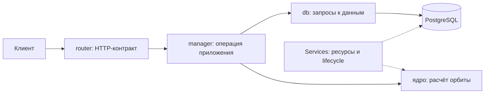

# Архитектура и причины выбора

Документ объясняет решения, которые нужно уметь защитить. В каждом разделе отдельно
указано, что работает в 1.2.0 и какие ограничения остаются у прототипа.

## 1. Один сервис и PostgreSQL

Сервис принимает описание орбиты и возвращает координаты, а также ведёт реестр аппаратов.
Эти обязанности относятся к одной предметной области и используют одну идентичность КА.
По заданию нет независимых команд, разных правил доступа или разных требований к масштабированию
для реестра и расчёта. Поэтому выбираем один микросервис.

Микросервисная архитектура определяется границами ответственности, владением данными
и явными контрактами. Количество процессов само по себе этого не определяет.
Отдельный процесс вычисления может оставаться внутренней частью одного сервиса.

Альтернативой были отдельные API, вычислительный сервис и очередь заданий.
Такой вариант удобен для длительных заданий, которые должны пережить отключение клиента,
но требует хранения статуса, повторной доставки, идемпотентности и согласования отказов.
Исходный контракт просит быстро вернуть результат запроса, поэтому эти механизмы пока не нужны.
Если измерения или новые требования покажут потребность в длительных заданиях, границу можно пересмотреть.

PostgreSQL обязателен по заданию. Он подходит для реестра: обеспечивает уникальность NORAD ID,
транзакции и проверяемую схему. Отдельное хранилище траекторий и кэш потребовали бы собственных
правил актуальности. Их необходимость сначала должна подтвердиться реальными запросами и замерами.

Работают расчёт, реестр, пользовательский доступ и Redis для общего ограничения частоты.

## 2. Разделение кода на слои

HTTP — протокол запросов и ответов. API (Application Programming Interface) — публичный
интерфейс приложения: какие запросы принимаются, что возвращается и какие ошибки возможны.
FastAPI отвечает за эту границу, документацию OpenAPI и вызов прикладного кода.



Путь расчёта проходит через manager и вычислительный пул до ядра в `api/orbits`.
Слой `db` содержит SQL реестра и пользователей. Manager задаёт границу операции,
а контекст `database.session()` фиксирует или откатывает транзакцию и закрывает сессию.

- `router` определяет маршрут, HTTP-коды, зависимости и модель ответа.
- `manager` выполняет прикладную операцию и определяет, какие действия связаны одной транзакцией.
- `db` содержит SQL и преобразование результатов в типизированные модели.
- `services` владеет инфраструктурой: подключениями, пулами и их запуском/остановкой.
- `models` содержит модели, а не доступ к данным.
- Ядро расчёта получает орбиту и времена и возвращает результат без зависимости от HTTP или БД.

Вычислительные обязанности оформлены двумя классами. `OrbitCalculator`
создаёт встроенную шкалу времени Skyfield один раз и хранит размер порции расчёта.
Методы проверки элементов, подготовки модели и расчёта используют это явное состояние.
`CalculationWorker` владеет вычислителем, сериализует ответ и измеряет время и память.
`Compute` управляет самим пулом, допуском работ и их жизненным циклом.

Модели данных вынесены в `models/pydantic`: `calculations.py` описывает неизменяемый
Pydantic-результат передачи между процессами, `benchmarks.py` — отчёты и снимок настроек.
В `benchmarks/settings.py` остаётся чтение окружения через BaseSettings.
Модели не импортируют прикладной код или инструмент benchmark.

Можно было поместить всё в обработчик FastAPI. При нескольких запросах это выглядит короче,
но смешивает проверку HTTP, транзакции и вычисления. Разделение позволяет отдельно проверять
математику, операции БД и внешний контракт. Дополнительные слои добавляем только при их использовании.

## 3. Контракты, ORM и драйвер

Pydantic проверяет структуру данных на границе приложения: обязательные поля, типы,
диапазоны и взаимные ограничения. DTO (Data Transfer Object) — типизированный объект передачи
данных между частями программы. Отдельные модели входа и ответа делают контракт явным.

SQLAlchemy — инструмент построения SQL и ORM (Object-Relational Mapping), то есть сопоставления
Python-моделей таблицам. ORM-модель описывает хранение, а модель API — допустимый обмен с клиентом.
Например, внутренние служебные поля таблицы не должны автоматически становиться полями запроса.

asyncpg — драйвер, который передаёт команды PostgreSQL и получает результаты асинхронно.
Цепочка доступа: прикладной код → SQLAlchemy → asyncpg → PostgreSQL.
Внешний HTTP-контракт остаётся одинаковым при изменении способа подключения к БД.

Pydantic описывает health, запросы TLE/OMM, точки траектории, вход, реестр, ошибки и настройки.
SQLAlchemy-модели описывают таблицы `users` и `satellites`; общее основание задаёт
единые имена ограничений для SQL-ошибок и миграций.

## 4. Асинхронность и вычисления

Асинхронный код полезен, когда запрос ждёт БД или сеть: в это время процесс обслуживает другие запросы.
Ожидание `await session.execute(...)` освобождает цикл обработки событий для другой работы.
Тяжёлый численный расчёт продолжает занимать процессор даже внутри `async def`.

Поэтому используется ограниченный пул вычислительных процессов. Он отделяет нагрузку ядра
от процесса HTTP. Векторизация передаёт библиотеке сразу массив времён, уменьшая
количество Python-вызовов. Ускорение нужно измерять: обмен данными между процессами и подготовка
большого JSON-ответа тоже занимают время и память.

Вариант с потоками проще по обмену памятью и может быть эффективен для библиотек, освобождающих
GIL (Global Interpreter Lock — механизм синхронизации выполнения Python-кода).
Для начала выбираем процессы как явную границу нагрузки; измерения определят число процессов
и показывают стоимость обмена. Первые результаты приведены в [замерах](benchmarks.md).

Пул ограничивает число допущенных работ количеством процессов. При исчерпании ресурса клиент получает 503.
Отмена HTTP-запроса сама по себе не гарантирует остановку уже выполняющегося процесса:
место освобождается callback-обработчиком фактически завершившегося Future.
Future — объект, представляющий результат ещё не законченной работы. Ожидающая HTTP-задача
защищает его через `asyncio.shield`: её отмена или тайм-аут не отменяют работу и не освобождают место.
Это поведение проверяется отдельными тестами.

Процессы создаются через `spawn`: у каждого собственная память и чистое состояние библиотек.
При запуске все процессы загружают встроенные таблицы времени, синхронизируются барьером
и выполняют пробы. Только после этого приложение готово принимать запросы.
Инициализатор `CalculationWorker.initialize` создаёт один экземпляр worker в каждом
дочернем процессе. ProcessPoolExecutor не передаёт результат инициализатора заданиям,
поэтому класс хранит ссылку на этот экземпляр в памяти своего процесса.
Методы `execute` и `probe` используют его; HTTP-процесс численный экземпляр не создаёт.
Повторные задания используют тот же вычислитель. После завершения процесса его память освобождается.
При остановке приём прекращается, а уже выполняющиеся работы завершаются.
Срок ожидания HTTP-ответа не является механизмом принудительного уничтожения процесса.
Python 3.13 ProcessPoolExecutor не предоставляет публичной операции убийства отдельной работы.

Векторизация разбита на порции `APP_COMPUTE_CHUNK_POINTS`: это ограничивает временные
массивы Skyfield и NumPy. Итоговые точки и JSON по-прежнему находятся в памяти целиком,
поэтому отдельно ограничено общее число точек. Процесс валидирует и сериализует ответ;
HTTP-процесс получает готовые bytes и отправляет их с объявленной схемой OpenAPI.
Передача между процессами всё равно копирует данные, что учитывается в HTTP-замерах.

По умолчанию один HTTP-процесс владеет двумя вычислительными процессами.
Численные библиотеки используют по одному потоку: без ограничения BLAS/OpenMP каждый
вычислитель мог бы дополнительно занять несколько ядер и ухудшить конкуренцию.
Лимит задаётся до импорта NumPy. Число вычислителей в приложении равно
`APP_HTTP_WORKERS × APP_COMPUTE_WORKERS`; память и native-потоки тоже умножаются.

Почему Skyfield вместе с sgp4: sgp4 реализует распространение средних элементов и возвращает
декартовы векторы TEME, а Skyfield выполняет преобразования систем отсчёта и геодезическое
преобразование WGS84. NumPy передаёт времена массивами. Собственная реализация уравнений
движения потребовала бы существенно большей численной проверки при том же контракте.
Встроенные таблицы времени фиксируются версией Skyfield; никаких сетевых загрузок при расчёте нет.
Для высокой точности в другой области дат потребуется отдельно обновлять и проверять эти таблицы.

## 5. Владение ресурсами

`Application` создаёт собственный экземпляр `Services`, который владеет PostgreSQL,
Redis, компонентом Auth, реестром метрик и вычислительным пулом.
FastAPI lifespan — контекст времени жизни приложения: код до `yield` запускает ресурсы,
код после него освобождает их.

`BaseServiceHub` использует `AsyncExitStack`, стандартный механизм Python для нескольких
асинхронных контекстов. Освобождение регистрируется до запуска ресурса. Поэтому даже если
запуск успел создать пул, а затем завершился ошибкой подключения, пул будет закрыт.
Ресурсы закрываются в обратном порядке; ошибка остановки одного не отменяет попытку закрыть остальные.

Альтернативой были глобальные клиенты, создаваемые при импорте модуля. Их состояние сложнее
изолировать в тестах и связывать с конкретным приложением. Фабрика `create_app()` создаёт
отдельное приложение, а реальные подключения появляются только при входе в lifespan.

Вызов `super().__init__(services=...)` передаёт базовому классу конкретные экземпляры
ресурсов. Один явный список управляет запуском, остановкой и готовностью.
Без этого вызова список не будет создан. Другая допустимая схема — общие атрибуты класса
и поиск компонентов через introspection, то есть просмотр атрибутов во время исполнения.
Здесь выбран конструктор: два приложения могут иметь разные настройки и ресурсы,
а в тестах их состояние не пересекается. Метрики не имеют соединений и не требуют запуска,
поэтому их реестр принадлежит `Services`, но не входит в список проверок готовности.

## 6. Пул соединений и транзакции

Пул повторно использует подключения к PostgreSQL. Создание нового соединения для каждого запроса
требовало бы повторять сетевое подключение и аутентификацию. Бесконтрольное число соединений
может исчерпать лимит БД, поэтому размер пула ограничен.

Начальные значения: один HTTP-процесс, до пяти постоянных соединений и ноль дополнительных.
Это стартовая конфигурация для замеров. Соединения открываются по мере необходимости.
При нескольких HTTP-процессах каждый имеет собственный пул: верхняя граница подключений
приложения равна `APP_HTTP_WORKERS × (APP_DB_POOL_SIZE + APP_DB_MAX_OVERFLOW)`.
Мигратор и тесты имеют отдельные подключения и в эту формулу не входят.

Транзакция объединяет изменения по правилу «всё или ничего». Успешное завершение фиксируется
операцией commit; ошибка приводит к rollback — откату сделанного внутри транзакции.

```python
async with services.database.session() as session:
    # Related DB calls receive this same session.
    ...
```

Контекст `session()` владеет фиксацией, откатом и закрытием сессии. Это стандартный
`async_sessionmaker.begin()` SQLAlchemy. Отмена асинхронной задачи тоже должна завершить
контекст и откатить изменения; это проверяется на настоящей PostgreSQL.
Операции реестра имеют собственные транзакции; расчёт получает элементы из запроса.

Ограничены три разные стадии: ожидание соединения в пуле, установление подключения
и выполнение SQL на стороне PostgreSQL. Общий срок healthcheck ограничен отдельно,
чтобы проверка готовности не зависала при отказе БД.

## 7. Миграции и запуск

Миграция — версионированное изменение схемы БД. Alembic сравнивает ORM metadata
(описание таблиц в Python) с фактической схемой и генерирует заготовку изменений.
Автогенерация требует просмотра: например, переименование поля может выглядеть как удаление и добавление.

В 0.1.0 начальная миграция отмечает исходную версию схемы; новая миграция 0.3.0 добавляет
таблицы `satellites` и `users` с ограничениями уникальности и допустимых значений.
Миграция 1.0.0 удаляет ненужный для демонстрации счётчик версии пользовательских токенов.
Предыдущие миграции сохранены: существующая БД обновляется без потери пользователей и реестра.
При откате возвращаются колонка с начальным значением и её проверка неотрицательности;
автогенерация удаления колонки сама не восстанавливает эту проверку в обратной операции.
Начальная миграция получена автогенерацией из пустой metadata. Alembic ведёт служебную
таблицу `alembic_version`. Интеграционный тест проверяет применение, повторное применение,
откат, восстановление ограничения и соответствие схемы metadata.

В Compose PostgreSQL сначала проходит проверку доступности по TCP. Затем отдельный
контейнер `migrate` выполняет `alembic upgrade head`. API запускается после успешного завершения мигратора.
Так несколько HTTP-процессов не пытаются одновременно менять схему при старте.
В масштабном развёртывании миграция аналогично должна выполняться отдельным шагом поставки.

## 8. Живость и готовность

`/health/live` отвечает, способен ли HTTP-процесс обслужить простой запрос. Он не обращается к БД.
`/health/ready` проверяет тот же список ресурсов `Services`, который используется для запуска
и остановки: PostgreSQL, Redis, Auth и вычислительный пул. Проверки выполняются
параллельно. Ответ пустой: `200`, если все ресурсы готовы, или `503`, если хотя бы один
недоступен либо его проверка выбросила исключение. Имя компонента и тип ошибки попадают в лог.
Отдельного списка проверок в менеджере нет, поэтому новый зарегистрированный ресурс
автоматически участвует в общей проверке. При свободном месте процесс получает короткую пробу;
одновременные проверки разделяют одну пробу. Проба имеет свой timeout.
Она не расходует места, выделенные для расчётов: иначе проверка ready могла бы вызвать
ложный `503 compute_busy` даже при одном обычном запросе. Во внутренней очереди может
находиться не больше одной такой пробы сверх допущенных расчётов.
Разделение помогает отличить отказ зависимости от зависания процесса.

Занятость всех процессов расчётами считается нормальной готовностью: перегрузка отражается
кодом 503 операции расчёта. Иначе балансировщик мог бы исключать исправные занятые экземпляры,
усиливая нагрузку на оставшиеся. Неуспешная незавершённая health-проба не маскируется занятостью.
Аварийное завершение процесса помечает пул сломанным. Автоматического перезапуска пула
внутри HTTP-процесса нет; для восстановления требуется перезапуск приложения.
Readiness сама по себе не перезапускает Docker-контейнер: локальный Compose показывает unhealthy.

Проверка готовности подтверждает доступность ресурсов, но не физическую достоверность входной орбиты.
Соответствие схемы проверяется миграциями и интеграционными тестами.
JSON-логи содержат время, уровень, имя компонента и сообщение; версия видна в startup-логе и health API.

## 9. Реестр и воспроизводимость расчёта

Клиент передаёт конкретные орбитальные элементы. Один запрос вычисляется
по одному набору, без автоматической загрузки более свежих данных посреди операции.
Это позволит воспроизвести результат с теми же входом, версиями библиотек и данными времени.

Реестр будет изменяться через явные API-операции. Автоматическое обновление названия и других
полей при каждом расчёте создало бы дополнительный эффект у вычислительного запроса и потребовало бы
правила разрешения конфликтующих метаданных. Поэтому выбран независимый жизненный цикл реестра.

Дату запуска передаёт клиент, когда она известна. Поле останется необязательным.
Эпоха орбиты — другой факт и не может заполнять дату запуска.

## 10. Зависимости, качество и версии

Python 3.13 соответствует ограничению 3.12+ из задания и принятому стеку сервисов.
Один minor Python упрощает воспроизводимость окружения. Docker и локальная `.venv` используют его же.
Poetry фиксирует точные версии и хеши пакетов в `poetry.lock`; стандартные метаданные проекта
находятся в `[project]` файла `pyproject.toml`.

Ruff проверяет ошибки и форматирование. ty анализирует типы и обращения к API библиотек
без запуска программы. Unit-тесты проверяют выбранные сценарии исполнения, а интеграционные —
реальное взаимодействие компонентов. Эти способы находят разные классы ошибок.

В pre-commit ty запускается на всём проекте с его зависимостями из Poetry.
Там же выполняются быстрые unit-тесты. Интеграционные проверки запускаются отдельно и в CI,
поскольку им нужны PostgreSQL и Redis. CI — автоматические проверки при push и pull request на GitHub.

Версия берётся из метаданных установленного проекта, поэтому HTTP и пакет используют один источник.
Ветки показывают этапы работы, коммиты — смысл изменений, теги — завершённые версии.
Теги 0.x сохраняют этапы разработки, а 1.0.0 фиксирует согласованный контракт прототипа.

Основные технические опоры: [lifespan FastAPI](https://fastapi.tiangolo.com/advanced/events/),
[асинхронная работа SQLAlchemy](https://docs.sqlalchemy.org/en/20/orm/extensions/asyncio.html),
[асинхронные миграции Alembic](https://alembic.sqlalchemy.org/en/latest/cookbook.html#using-asyncio-with-alembic),
[SemVer](https://semver.org/).

## 11. Решения реестра и пользовательского доступа

Реестр хранит метаданные отдельно от элементов орбиты. NORAD ID связывает запись с внешним
каталогом, но вводимые пользователем данные могут потребовать исправления. Поэтому внутренний
UUID, то есть универсальный уникальный идентификатор, не меняется при исправлении NORAD ID.
PostgreSQL обеспечивает уникальность NORAD ID и при одновременных запросах; предварительная
проверка наличия без ограничения БД не защитила бы от гонки двух операций создания.
Диапазон допускает девять цифр, как контракт JSON элементов. Число хранится как `bigint`.
`launch_date` необязательна: момент, к которому относятся орбитальные элементы, не является датой запуска.

Полная замена PUT выбрана вместо частичного PATCH, чтобы различие между отсутствующим полем
и явным `null` не усложняло маленькую модель. UUID сохраняется, необязательные пропущенные
поля очищаются. Для совместного редактирования без перезаписи чужих изменений потребовались бы
версия записи и условный запрос; такого требования нет, применяется последняя успешная транзакция.
Список ограничен страницей: пагинация по NORAD ID использует уникальный индекс и продолжение
`after_norad_id`. Она не читает и не отбрасывает всё растущее начало списка, как большой `OFFSET`.
Снимок нескольких страниц не фиксируется; изменение NORAD ID между чтениями может переместить запись.

Вход, JWT (подписанный JSON-токен), Argon2 (алгоритм хеширования паролей) и Redis для общих
квот подробно разобраны в [доступе и ограничениях](access.md), включая рассмотренные альтернативы.
`Services.auth` владеет проверкой паролей, подписью и проверкой токенов.
`AuthManager` координирует чтение пользователя, проверку через Auth и квоты Redis.
HTTP-контракт остаётся в router, SQL — в db. Auth является внутренним компонентом этого
микросервиса: отдельное сетевое приложение для демонстрационного входа не требуется.
Все подключения и фоновые проверки имеют одного владельца `Services`.
Проверка пользователя выполняется короткой транзакцией до расчёта; удерживать подключение
во время многосекундной численной работы не требуется.
Redis нужен именно для счётчиков между процессами и экземплярами приложения.
Расчётное ядро остаётся независимым от пользователей, Redis и PostgreSQL.

Демонстрационный пользователь добавляется функцией из `api/demo_user.py`.
Команда `docker compose exec app python -m api.demo_user` запускает её внутри контейнера;
задача `poetry run poe add-test-user` ссылается на ту же функцию для локальной разработки.
Она переиспользует хеширование паролей, DB-запрос и транзакцию сервиса.
Ограничение уникальности PostgreSQL сохраняет уже существующую запись.

## 12. Метрики Prometheus

Prometheus периодически читает числовые показатели приложения по HTTP и хранит их историю.
Сервис предоставляет `/metrics` через открытую библиотеку `prometheus-client`.
Сервер Prometheus и Grafana в Compose не добавлены: для демонстрации экспорта достаточно
`curl http://localhost:8000/metrics`. Историю и графики сам endpoint не хранит.

Экспортируются две группы показателей:

- `orbit_http_requests_total` — накопленное число запросов;
- `orbit_http_request_duration_seconds` — гистограмма времени ответа в секундах.

Гистограмма считает запросы в диапазонах времени: `_bucket` содержит число наблюдений
не больше границы `le`, `_count` — общее число, `_sum` — сумму времени.
Границы задаёт `APP_METRICS_HTTP_BUCKETS_SEC`; начальный набор покрывает быстрые операции
и расчёты до 60 секунд. Prometheus использует эти диапазоны для приблизительной оценки
процентилей. Например, p95 — время, в которое укладываются 95% запросов.

Обе группы имеют метки `method`, `route`, `status`. Метка route содержит шаблон,
например `/api/v1/satellites/{satellite_id}`, а неизвестные пути объединяются в `unmatched`.
Неизвестные HTTP-методы объединяются в `OTHER`. UUID, параметры запроса, логины и токены
не создают отдельных рядов. Иначе каждый новый аппарат или случайный URL увеличивал бы
объём хранилища метрик. Запросы к `/health/live`, `/health/ready` и `/metrics` исключены,
чтобы служебные опросы не определяли статистику бизнес-операций.

Middleware — код вокруг HTTP-обработчика. Он записывает статус и время после выполнения
приложения, включая валидацию, авторизацию, ожидание расчёта и отправку тела серверу.
Это время обслуживания запроса, а не только работа вычислительного ядра и не время
доставки по сети до клиента. Учитываются также `401`, `422`, `429`, `503` и необработанные
ошибки `500`. Содержимое ответов и ошибок не попадает в метки.

При одном HTTP-процессе метрики находятся в памяти, в отдельном реестре приложения.
При нескольких процессах запуск `python -m api` (также `poe start` и Docker) создаёт
общий временный каталог метрик и передаёт его процессам до импорта приложения.
Используется [штатный multiprocess-режим клиента](https://prometheus.github.io/client_python/multiprocess/):
любой HTTP-процесс отдаёт общую сумму. Каталог удаляется при нормальной остановке;
новый запуск получает новый каталог, поэтому старые счётчики не подмешиваются.
Вычислительные процессы не создают HTTP-метрик. Для поддержанного запуска используйте
точки входа проекта; прямой запуск нескольких workers командой `uvicorn` обходит подготовку каталога.
ASGI-тесты также используют отдельный реестр каждого экземпляра приложения.

Endpoint открыт без токена и квоты пользователя, как healthcheck.
`APP_METRICS_ENABLED=false` отключает сбор и возвращает `404` на `/metrics`.
Для внешнего развёртывания доступ к нему можно ограничить инфраструктурой.

Если подключить сервер Prometheus с целью сбора `localhost:8000`, частота запросов
в секунду за последние пять минут вычисляется так:

```promql
sum by (route, method, status) (rate(orbit_http_requests_total[5m]))
```

Приближённый p95 по маршруту в секундах:

```promql
histogram_quantile(0.95, sum by (le, route) (rate(orbit_http_request_duration_seconds_bucket[5m])))
```

Обе формулы выполняются в Prometheus, когда он уже накопил наблюдения.
