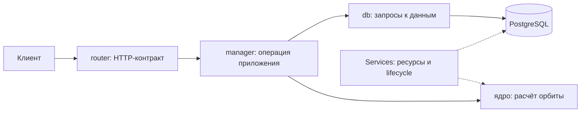

# Архитектура и причины выбора

Документ объясняет решения, которые нужно уметь защитить. В каждом разделе отдельно
указано, что работает в 0.1.0, а что относится к следующим версиям.

## 1. Один сервис и PostgreSQL

Сервис принимает описание орбиты и возвращает координаты, а также ведёт реестр аппаратов.
Эти обязанности относятся к одной предметной области и используют одну идентичность КА.
По заданию нет независимых команд, разных правил доступа или разных требований к масштабированию
для реестра и расчёта. Поэтому выбираем один микросервис.

Микросервисная архитектура определяется границами ответственности, владением данными
и явными контрактами. Количество процессов само по себе этого не определяет.
Отдельный процесс вычисления может оставаться внутренней частью одного сервиса.

Альтернативой были отдельные API, вычислительный сервис и очередь заданий.
Такой вариант удобен для длительных заданий, которые должны пережить отключение клиента,
но требует хранения статуса, повторной доставки, идемпотентности и согласования отказов.
Исходный контракт просит быстро вернуть результат запроса, поэтому эти механизмы пока не нужны.
Если измерения или новые требования покажут потребность в длительных заданиях, границу можно пересмотреть.

PostgreSQL обязателен по заданию. Он подходит для реестра: обеспечивает уникальность NORAD ID,
транзакции и проверяемую схему. Отдельное хранилище траекторий и кэш потребовали бы собственных
правил актуальности. Их необходимость сначала должна подтвердиться реальными запросами и замерами.

В 0.1.0 работают API, PostgreSQL и миграции. Реестр появится в 0.3.0.

## 2. Разделение кода на слои

HTTP — протокол запросов и ответов. API (Application Programming Interface) — публичный
интерфейс приложения: какие запросы принимаются, что возвращается и какие ошибки возможны.
FastAPI отвечает за эту границу, документацию OpenAPI и вызов прикладного кода.



Схема показывает итоговую архитектуру. В 0.1.0 реализован путь health-запроса до PostgreSQL.
Слой `db` и вычислительное ядро будут добавлены при появлении использующих их операций.

- `router` определяет маршрут, HTTP-коды, зависимости и модель ответа.
- `manager` выполняет прикладную операцию и определяет, какие действия связаны одной транзакцией.
- `db` содержит SQL и преобразование результатов в типизированные модели.
- `services` владеет инфраструктурой: подключениями, пулами и их запуском/остановкой.
- `models` содержит модели, а не доступ к данным.
- Ядро расчёта получает орбиту и времена и возвращает результат без зависимости от HTTP или БД.

Можно было поместить всё в обработчик FastAPI. При нескольких запросах это выглядит короче,
но смешивает проверку HTTP, транзакции и вычисления. Разделение позволяет отдельно проверять
математику, операции БД и внешний контракт. Дополнительные слои добавляем только при их использовании.

## 3. Контракты, ORM и драйвер

Pydantic проверяет структуру данных на границе приложения: обязательные поля, типы,
диапазоны и взаимные ограничения. DTO (Data Transfer Object) — типизированный объект передачи
данных между частями программы. Отдельные модели входа и ответа делают контракт явным.

SQLAlchemy — инструмент построения SQL и ORM (Object-Relational Mapping), то есть сопоставления
Python-моделей таблицам. ORM-модель описывает хранение, а модель API — допустимый обмен с клиентом.
Например, внутренние служебные поля таблицы не должны автоматически становиться полями запроса.

asyncpg — драйвер, который передаёт команды PostgreSQL и получает результаты асинхронно.
Цепочка доступа: прикладной код → SQLAlchemy → asyncpg → PostgreSQL.
Внешний HTTP-контракт остаётся одинаковым при изменении способа подключения к БД.

В 0.1.0 Pydantic описывает health-ответы и настройки. Для будущих таблиц подготовлено основание
SQLAlchemy с едиными именами ограничений. Бизнес-таблицы ещё не создаются.

## 4. Асинхронность и вычисления

Асинхронный код полезен, когда запрос ждёт БД или сеть: в это время процесс обслуживает другие запросы.
Ожидание `await session.execute(...)` освобождает цикл обработки событий для другой работы.
Тяжёлый численный расчёт продолжает занимать процессор даже внутри `async def`.

Поэтому для 0.2.0 выбран ограниченный пул вычислительных процессов. Он отделит нагрузку ядра
от процесса HTTP. Векторизация будет передавать библиотеке сразу массив времён, уменьшая
количество Python-вызовов. Ускорение нужно измерять: обмен данными между процессами и подготовка
большого JSON-ответа тоже занимают время и память.

Вариант с потоками проще по обмену памятью и может быть эффективен для библиотек, освобождающих
GIL (Global Interpreter Lock — механизм синхронизации выполнения Python-кода).
Для начала выбираем процессы как явную границу нагрузки; измерения определят число процессов
и покажут, оправдана ли стоимость обмена. Окончательных характеристик производительности пока нет.

Пул будет иметь ограничение допущенных запросов. При исчерпании ресурса клиент получит 503.
Отмена HTTP-запроса сама по себе не гарантирует остановку уже выполняющегося процесса:
при реализации отдельно проверим освобождение занятого места после завершения вычисления.

В 0.1.0 вычислительного пула и его настроек ещё нет. HTTP работает одним процессом по умолчанию.

## 5. Владение ресурсами

`Application` создаёт собственный экземпляр `Services`, который владеет PostgreSQL.
FastAPI lifespan — контекст времени жизни приложения: код до `yield` запускает ресурсы,
код после него освобождает их.

`BaseServiceHub` использует `AsyncExitStack`, стандартный механизм Python для нескольких
асинхронных контекстов. Освобождение регистрируется до запуска ресурса. Поэтому даже если
запуск успел создать пул, а затем завершился ошибкой подключения, пул будет закрыт.
Ресурсы закрываются в обратном порядке; ошибка остановки одного не отменяет попытку закрыть остальные.

Альтернативой были глобальные клиенты, создаваемые при импорте модуля. Их состояние сложнее
изолировать в тестах и связывать с конкретным приложением. Фабрика `create_app()` создаёт
отдельное приложение, а реальные подключения появляются только при входе в lifespan.

## 6. Пул соединений и транзакции

Пул повторно использует подключения к PostgreSQL. Создание нового соединения для каждого запроса
требовало бы повторять сетевое подключение и аутентификацию. Бесконтрольное число соединений
может исчерпать лимит БД, поэтому размер пула ограничен.

Начальные значения: один HTTP-процесс, до пяти постоянных соединений и ноль дополнительных.
Это стартовая конфигурация для замеров. Соединения открываются по мере необходимости.
При нескольких HTTP-процессах каждый имеет собственный пул: верхняя граница подключений
приложения равна `APP_HTTP_WORKERS × (APP_DB_POOL_SIZE + APP_DB_MAX_OVERFLOW)`.
Мигратор и тесты имеют отдельные подключения и в эту формулу не входят.

Транзакция объединяет изменения по правилу «всё или ничего». Успешное завершение фиксируется
операцией commit; ошибка приводит к rollback — откату сделанного внутри транзакции.

```python
async with services.database.session() as session:
    # Related DB calls receive this same session.
    ...
```

Контекст `session()` владеет фиксацией, откатом и закрытием сессии. Это стандартный
`async_sessionmaker.begin()` SQLAlchemy. Отмена асинхронной задачи тоже должна завершить
контекст и откатить изменения; это проверяется на настоящей PostgreSQL.
Транзакция будущего реестра завершится до начала длительного расчёта.

Ограничены три разные стадии: ожидание соединения в пуле, установление подключения
и выполнение SQL на стороне PostgreSQL. Общий срок healthcheck ограничен отдельно,
чтобы проверка готовности не зависала при отказе БД.

## 7. Миграции и запуск

Миграция — версионированное изменение схемы БД. Alembic сравнивает ORM metadata
(описание таблиц в Python) с фактической схемой и генерирует заготовку изменений.
Автогенерация требует просмотра: например, переименование поля может выглядеть как удаление и добавление.

В 0.1.0 начальная миграция отмечает исходную версию схемы; таблицы реестра добавятся в 0.3.0.
Начальная миграция получена автогенерацией из пустой metadata. Alembic ведёт служебную
таблицу `alembic_version`. Интеграционный тест проверяет применение, повторное применение,
откат и соответствие схемы metadata.

В Compose PostgreSQL сначала проходит проверку доступности по TCP. Затем отдельный
контейнер `migrate` выполняет `alembic upgrade head`. API запускается после успешного завершения мигратора.
Так несколько HTTP-процессов не пытаются одновременно менять схему при старте.
В масштабном развёртывании миграция аналогично должна выполняться отдельным шагом поставки.

## 8. Живость и готовность

`/health/live` отвечает, способен ли HTTP-процесс обслужить простой запрос. Он не обращается к БД.
`/health/ready` выполняет проверку PostgreSQL и возвращает 503 при её недоступности.
Разделение помогает отличить отказ зависимости от зависания процесса.

Проверка 0.1.0 подтверждает соединение с PostgreSQL, а не полноту всех будущих бизнес-операций.
Соответствие схемы проверяется миграциями и интеграционными тестами.
JSON-логи содержат время, уровень, имя компонента и сообщение; версия видна в startup-логе и health API.

## 9. Реестр и воспроизводимость расчёта

Клиент будущего endpoint передаст конкретные орбитальные элементы. Один запрос будет вычисляться
по одному набору, без автоматической загрузки более свежих данных посреди операции.
Это позволит воспроизвести результат с теми же входом, версиями библиотек и данными времени.

Реестр будет изменяться через явные API-операции. Автоматическое обновление названия и других
полей при каждом расчёте создало бы дополнительный эффект у вычислительного запроса и потребовало бы
правила разрешения конфликтующих метаданных. Поэтому выбран независимый жизненный цикл реестра.

Дату запуска передаёт клиент, когда она известна. Поле останется необязательным.
Эпоха орбиты — другой факт и не может заполнять дату запуска.

## 10. Зависимости, качество и версии

Python 3.13 соответствует ограничению 3.12+ из задания и принятому стеку сервисов.
Один minor Python упрощает воспроизводимость окружения. Docker и локальная `.venv` используют его же.
Poetry фиксирует точные версии и хеши пакетов в `poetry.lock`; стандартные метаданные проекта
находятся в `[project]` файла `pyproject.toml`.

Ruff проверяет ошибки и форматирование. ty анализирует типы и обращения к API библиотек
без запуска программы. Unit-тесты проверяют выбранные сценарии исполнения, а интеграционные —
реальное взаимодействие компонентов. Эти способы находят разные классы ошибок.

В pre-commit ty запускается на всём проекте с его зависимостями из Poetry.
Там же выполняются быстрые unit-тесты. Интеграционные проверки запускаются отдельно и в CI,
поскольку им нужна PostgreSQL. CI — автоматические проверки при push и pull request на GitHub.

Версия берётся из метаданных установленного проекта, поэтому HTTP и пакет используют один источник.
Ветки показывают этапы работы, коммиты — смысл изменений, теги — завершённые версии.
0.1.0 проверяет основание сервиса, а 1.0.0 зафиксирует полный согласованный контракт прототипа.

Основные технические опоры: [lifespan FastAPI](https://fastapi.tiangolo.com/advanced/events/),
[асинхронная работа SQLAlchemy](https://docs.sqlalchemy.org/en/20/orm/extensions/asyncio.html),
[асинхронные миграции Alembic](https://alembic.sqlalchemy.org/en/latest/cookbook.html#using-asyncio-with-alembic),
[SemVer](https://semver.org/).
